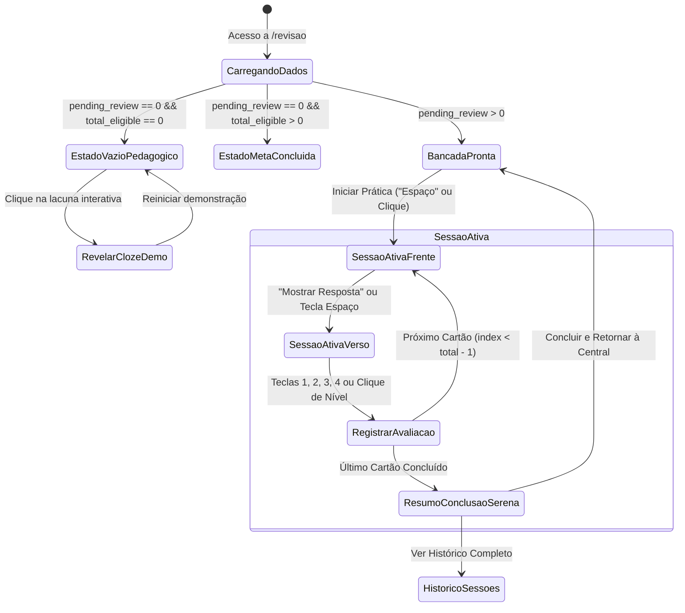

# Data Model & State Architecture: F0.8.03 — Revisão: Bancada de Fixação Cognitiva

**Feature Branch**: `068-revisao-bancada-fixacao` | **Date**: 2026-10-11 | **Spec**: [spec.md](spec.md)

Este documento descreve as entidades de dados, contratos de estado reativo e fluxos de transição da Central de Revisão.

---

## 1. Entidades Conceituais e Interfaces TypeScript

### 1.1 Item de Revisão (`ReviewItemRead`)

Representa a unidade fundamental de teste de *Active Recall*.

```typescript
export type ReviewItemKind = 'question' | 'hidden'
export type ReviewRating = 'again' | 'hard' | 'medium' | 'easy'

export interface ReviewItemRead {
  id: number
  kind: ReviewItemKind
  prompt: string                // Pergunta formulada ou frase com lacuna de cloze
  answer: string                // Resposta reflexiva ou termo omitido revelado
  book_id: number | null
  book_title: string | null
  chapter_id: number | null
  chapter_title: string | null
  study_id: number
  study_title: string
  location: string | null       // Ex: "p. 42" ou marcador de posição
  review_count: number
  last_rating: ReviewRating | null
  last_reviewed_at: string | null
  next_review_at: string | null
}
```

### 1.2 Métricas de Prontidão Intelectual (`ReviewReadinessMetrics`)

Consolidação sintetizada para o componente `ReviewStatsHeader.vue` / `ReviewReadinessBar.vue`:

```typescript
export interface ReviewReadinessMetrics {
  total_eligible: number        // Total de cartões no acervo
  total_questions: number       // Perguntas reflexivas
  total_hidden: number          // Termos ocultos (clozes)
  reviewed_today: number        // Cartões já concluídos na data atual
  pending_review: number        // Cartões aguardando prática hoje
  estimated_minutes: number     // Estimativa temporal recomendada (ex: ceil(pending * 0.6))
  books_summary: Array<{
    id: number
    title: string
    pending_count: number
  }>
}
```

### 1.3 Estado da Sessão Ativa (`ReviewSessionState`)

Controlado centralmente pelo composable `useReviewSession.ts`:

```typescript
export interface ReviewSessionState {
  items: ReviewItemRead[]
  currentIndex: number
  isRevealed: boolean           // Frente (false) vs Verso (true)
  isCompleted: boolean          // Transição para tela de conclusão serena
  ratings: Record<number, ReviewRating>
  startedAt: Date | null
  elapsedSeconds: number
  loading: boolean
  submitting: boolean
  error: string | null
}
```

### 1.4 Modelo de Demonstração de Termo Oculto (`PedagogicalClozeDemo`)

Utilizado no estado vazio instrutivo (`ReviewPedagogicalEmpty.vue`):

```typescript
export interface PedagogicalClozeDemo {
  passagePrefix: string         // Ex: "A leitura reflexiva exige pausar e"
  hiddenTerm: string            // Ex: "recuperar"
  passageSuffix: string         // Ex: "o sentido com as próprias palavras."
  isRevealed: boolean
  explanation: string
}
```

---

## 2. Máquina de Estados da Central de Revisão



---

## 3. Mapeamento de Atalhos de Teclado Ergonômicos

| Atalho | Contexto | Ação Disparada |
|---|---|---|
| `Espaço` | Sessão Ativa / Cartão Oculto | Revela a resposta (verso) do cartão |
| `1` | Resposta Revelada | Classifica como **Errei** (`again`) e avança |
| `2` | Resposta Revelada | Classifica como **Difícil** (`hard`) e avança |
| `3` | Resposta Revelada | Classifica como **Bom** (`medium`) e avança |
| `4` | Resposta Revelada | Classifica como **Fácil** (`easy`) e avança |
| `Escape` | Sessão Ativa | Solicita interrupção ou fecha modal de resumo |

---

## 4. Garantia de Imunidade Cromática e Acessibilidade

- Todos os componentes utilizam variáveis semânticas do tema ativo:
  - Fundo do cartão de revisão: `var(--bg-surface)`
  - Bordas táteis: `var(--border-subtle)` / `var(--border-strong)`
  - Texto de desafio: `var(--text-primary)` com `--font-serif`
  - Contexto de metadados: `var(--text-muted)`
  - Destaque de cloze revelado: `var(--accent-subtle)` com texto `var(--accent-primary)`
- Dimensões táteis mínimas de $44 \times 44$px em todos os controles móveis (WCAG 2.1 Critério 2.5.5).
