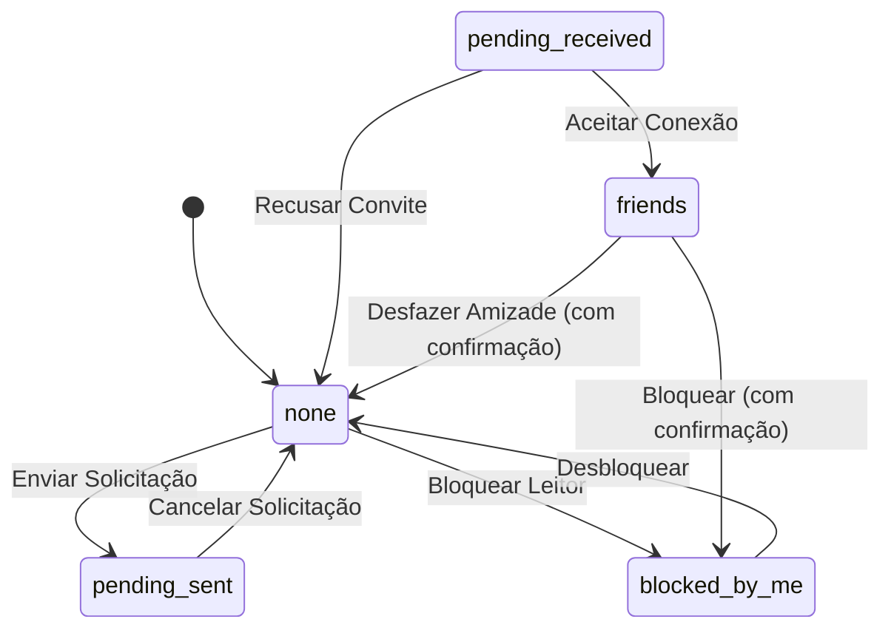

# Modelo de Dados e Estados Reativos: F0.8.06 — Amigos: Salão Literário e Círculos de Estudo

**Feature Branch**: `071-amigos-salao-literario`  
**Data**: 2026-10-11  
**Status**: Concluído (Fase 1 do Spec Kit)

---

## 1. Entidades de Dados (Frontend / API)

A Feature F0.8.06 preserva integralmente os contratos e estruturas da API REST existente (`backend/app/routers/friends.py` e `backend/app/routers/profile.py`). Não há alterações no banco de dados SQLite local nem criação de novas tabelas.

### 1.1. `FriendUser` (Perfil do Leitor Conectado)

Representa os dados públicos essenciais de um usuário em contextos de listagem social e busca.

| Campo | Tipo | Descrição | Regras de Validação |
|---|---|---|---|
| `id` | `string` | UUID do usuário no Leitorum. | Identificador único e imutável. |
| `username` | `string` | Identificador único (`@username`) do leitor. | Alfanumérico, sem espaços, 3 a 30 caracteres. |
| `display_name` | `string` | Nome de exibição público do leitor. | Não vazio, máximo 60 caracteres. |
| `avatar_url` | `string \| null` | URL para imagem de avatar do perfil. | URL válida ou nulo (renderiza iniciais). |
| `bio` | `string \| null` | Breve nota biográfica ou interesses de leitura. | Opcional, texto curto sanitizado. |

---

### 1.2. `FriendItem` (Conexão do Círculo Literário)

Representa uma amizade consolidada exibida na aba "Círculo de Leitura".

| Campo | Tipo | Descrição | Regras de Validação |
|---|---|---|---|
| `friendship_id` | `number` | Identificador numérico da relação de amizade. | Inteiro positivo. |
| `user` | `FriendUser` | Dados do leitor amigo. | Objeto de leitor válido. |
| `since` | `string` | Timestamp ISO 8601 da consolidação da amizade. | Formato UTC ISO para formatação em pt-BR. |

---

### 1.3. `FriendRequestItem` (Solicitação de Correspondência)

Representa um convite pendente enviado ou recebido.

| Campo | Tipo | Descrição | Regras de Validação |
|---|---|---|---|
| `request_id` | `number` | Identificador único do pedido de conexão. | Inteiro positivo. |
| `user` | `FriendUser` | Dados do leitor requerente ou destinatário. | Objeto de leitor válido. |
| `direction` | `'sent' \| 'received'` | Direção do convite social. | `'received'` (recebido) ou `'sent'` (enviado). |
| `created_at` | `string` | Timestamp ISO 8601 do envio do convite. | Formato UTC ISO para formatação em pt-BR. |

---

### 1.4. `FriendBlockedItem` (Leitor Bloqueado)

Representa um usuário bloqueado pelo leitor logado.

| Campo | Tipo | Descrição | Regras de Validação |
|---|---|---|---|
| `friendship_id` | `number` | Identificador do registro de bloqueio. | Inteiro positivo. |
| `user` | `FriendUser` | Dados do leitor bloqueado. | Objeto de leitor válido. |
| `blocked_at` | `string` | Timestamp ISO 8601 do momento do bloqueio. | Formato UTC ISO. |

---

### 1.5. `FriendsSummary` (Sumário Social e Contadores)

Consolidado estatístico consumido no cabeçalho e nos badges das abas.

| Campo | Tipo | Descrição | Regras de Validação |
|---|---|---|---|
| `friends_count` | `number` | Quantidade total de amigos ativos no círculo. | Inteiro $\ge 0$. |
| `pending_received_count` | `number` | Quantidade de convites recebidos aguardando resposta. | Inteiro $\ge 0$. |
| `pending_sent_count` | `number` | Quantidade de convites enviados aguardando aceite. | Inteiro $\ge 0$. |

---

### 1.6. `UserSearchItem` (Resultado da Busca por Pares)

Estrutura de dados retornada pelo endpoint `/api/profile/search`.

| Campo | Tipo | Descrição | Regras de Validação |
|---|---|---|---|
| `username` | `string` | Identificador único do leitor encontrado. | Obrigatório. |
| `display_name` | `string` | Nome de exibição do leitor. | Obrigatório. |
| `avatar_url` | `string \| null` | URL do avatar ou nulo. | Opcional. |
| `bio` | `string \| null` | Bio literária do leitor. | Opcional. |

---

## 2. Tipos de Navegação e Perspectiva Social

### 2.1. `SocialActiveTab`
Define as 4 abas segmentadas da experiência do Salão Literário:
```typescript
export type SocialActiveTab = 'friends' | 'requests' | 'discover' | 'blocked'
```

- `'friends'`: **Círculo de Leitura** — Lista os amigos consolidados e o estado vazio de círculo em formação.
- `'requests'`: **Solicitações** — Apresenta seções divididas de convites recebidos e convites enviados.
- `'discover'`: **Descobrir Leitores** — Campo de pesquisa com sugestões de exploração intelectual.
- `'blocked'`: **Bloqueados** — Gerenciamento defensivo de leitores bloqueados com ação de desbloqueio.

---

### 2.2. `RelationPerspectiveStatus`
Reflete o vínculo do ponto de vista do usuário logado:
```typescript
export type RelationPerspectiveStatus =
  | 'none'              // Sem vínculo existente
  | 'pending_sent'      // Solicitação enviada pelo usuário
  | 'pending_received'  // Solicitação recebida pelo usuário
  | 'friends'           // Amigos mútuos
  | 'blocked_by_me'     // Usuário bloqueado pelo usuário logado
  | 'blocked_by_them'   // Usuário bloqueou o usuário logado
```

---

## 3. Estados Reativos de Interface (UI State)

### 3.1. Estado do Cartão de Identidade (`BookplateCard.vue`)

```typescript
export interface BookplateCardState {
  /** Se o selo de confirmação de cópia está ativo no momento */
  isStamped: boolean
  /** Se a operação de compartilhamento está em processamento */
  isSharing: boolean
  /** Mensagem temporária de feedback para compartilhamento via link (desktop fallback) */
  shareFeedback: string | null
}
```

### 3.2. Ciclo de Vida do Selo de Cópia Confirmada

```text
[Clique em Copiar @identificador]
       │
       ▼
[Clipboard: navigator.clipboard.writeText(`@${username}`)]
       │
       ▼
[Estado: isStamped = true (.is-stamped aplicada)]
       │
       ├── Transição CSS: transform scale(1.04), pulso sutil de selo literário
       │
       ▼ (Aguardar exatamente 1200ms via setTimeout)
[Estado: isStamped = false]
       │
       ▼
[Retorno suave ao estado inicial de repouso]
```

### 3.3. Ciclo de Vida do Compartilhamento de Perfil

```text
[Clique em Compartilhar Perfil]
       │
       ├── Se typeof navigator.share === 'function' (Móvel / PWA)
       │      │
       │      ▼
       │   navigator.share({
       │     title: `${displayName} no Leitorum`,
       │     text: `Acompanhe minhas leituras e cadernos de estudo no Leitorum:`,
       │     url: `${origin}/u/${username}`
       │   })
       │
       └── Se navigator.share for indefinido (Desktop Clássico)
              │
              ▼
           navigator.clipboard.writeText(`${origin}/u/${username}`)
              │
              ▼
           Exibir selo "Link do perfil copiado!" por 1200ms
```

---

## 4. Máquina de Estados da Relação Social


