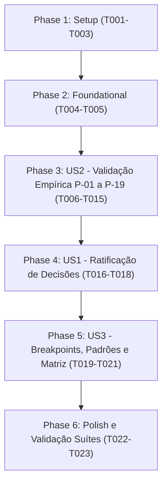

# Tasks: Estratégia Responsiva — Inventário, Validação e Decisões

**Feature**: `076-estrategia-responsiva` | **Spec**: [spec.md](spec.md) | **Plan**: [plan.md](plan.md)

---

## Phase 1: Setup (Infraestrutura de Pesquisa e Ambiente)

**Purpose**: Estruturar documentação de pesquisa inicial e preparar ambiente isolado com dados fictícios.

- [x] T001 Criar `specs/076-estrategia-responsiva/research.md` transcrevendo as Partes A–C da auditoria (P-01 a P-19 com evidência, severidade e confiança), todos com status inicial "pendente de validação".
- [x] T002 Escrever `specs/076-estrategia-responsiva/quickstart.md`: instruções para subir backend com `CADERNO_DATABASE_PATH` temporário e porta efêmera, semear dados sintéticos pela interface, lista de viewports canônicas (320, 375, 390, 430, 767, 768, 1023, 1024, 1440, 844×390 paisagem) e alternância de temas (1 claro, 1 escuro).
- [x] T003 Semear e documentar o conjunto fictício de testes: 1 livro, 3 capítulos, ≥12 estudos em um capítulo, árvore com 5 níveis de profundidade, ≥8 relações semânticas, 2 molduras no Canvas, 1 admin e 1 usuário comum, garantindo isolamento total de `backend/data/caderno.db`.

---

## Phase 2: Foundational (Bloqueios e Teste-Guarda Automatizado)

**Purpose**: Contrato de decisões preliminar e teste de integridade que bloqueia as histórias de usuário.

- [x] T004 Criar `specs/076-estrategia-responsiva/contracts/responsive-decisions.contract.md` com a matriz de cobertura completa (25 rotas de `src/router/index.ts`, 5 visualizações, shell e overlays) e classificações preliminares de 1 a 5.
- [x] T005 [P] Criar teste automatizado `caderno-leitura-0.1/frontend/tests/feature-076-responsive-inventory.test.mjs` que inspeciona `src/router/index.ts` e exige que todo `name:` nomeado conste obrigatoriamente de `responsive-decisions.contract.md`.

---

## Phase 3: User Story 2 - Validação Empírica dos Problemas P-01 a P-19 (Priority: P1)

**Goal**: Reproduzir ou refutar empiricamente os 19 problemas da auditoria e registrar medições/evidências por viewport.

**Independent Test**: Verificar se cada problema P-xx em `research.md` possui status explícito (Confirmado, Refutado ou Parcial) e evidência/registro associado.

- [x] T006 [US2] Linha de base da viewport: para cada rota e breakpoint (320, 375, 767, 1024, 1440px), verificar ocorrência de overflow horizontal involuntário (`scrollWidth > clientWidth`) e registrar em `specs/076-estrategia-responsiva/evidence/`.
- [x] T007 [US2] P-01 e P-02: em 375 e 767px autenticado, registrar estado real do header e rodapé, a orfandade da classe `.main-nav` no CSS e o espaço de padding-bottom reservado em `#app`.
- [x] T008 [US2] P-03: inspecionar `components/sharing/ShareModal.vue` e registrar as classes Tailwind ausentes (`fixed`, `inset-0`, `z-50`) e medir uso de utilitários em `CategoryBadge.vue`, `StudyView.vue` e `BookView.vue`.
- [x] T009 [US2] P-04 e P-05: Map View em 375px com toque emulado — avaliar pan, zoom e toques nos badges de aresta; registrar número de nós visíveis a 100%.
- [x] T010 [US2] P-06 e P-07: Canvas View em 375px e 768×1024px com toque emulado — avaliar rolagem de página sobre `touch-action: none`, ausência de pinch, movimentação de card e rolagem da toolbar.
- [x] T011 [US2] P-08: Tree View de 5 níveis em 320px — medir largura útil do título no 5º nível de profundidade e verificar alça de arrasto em 1024px com `pointer: coarse`.
- [x] T012 [P] [US2] P-09 e P-10: verificar ancoragem de `NotificationsDropdown` em telas ≤430px e verificar offsets dos elementos fixos inferiores (toasts, batch bar da Lixeira, FAB de Ajustes).
- [x] T013 [P] [US2] P-12: verificar Map e Grid View em 1024 e 1280px com os dois painéis laterais de `SplitLayout` abertos.
- [x] T014 [P] [US2] P-14 a P-17: inspecionar `/admin` em 375px; testar grids com `minmax(280px, 1fr)` em 320px; avaliar modais com formulário e primeiro acesso a `BookView` em 375px com `localStorage` limpo.
- [x] T015 [US2] Atualizar `specs/076-estrategia-responsiva/research.md` com o status final (Confirmado/Refutado/Parcial) de cada problema P-01 a P-19 e registrar eventuais novos problemas (P-20+).

---

## Phase 4: User Story 1 - Decisões Arquiteturais Ratificadas por Tela (Priority: P1)

**Goal**: Ratificar a classificação de todas as 25 rotas, layouts e visualizações de estudos no contrato de decisões.

**Independent Test**: Conferir `contracts/responsive-decisions.contract.md` com 100% das rotas e visualizações detalhadas com justificativas e funções preservadas.

- [x] T016 [US1] Revisar e consolidar a classificação (1 a 5) de cada uma das 25 rotas e overlays à luz dos achados de T006–T015 em `contracts/responsive-decisions.contract.md`.
- [x] T017 [US1] Incluir no contrato as seções detalhadas de Map, Canvas e Tree (diagnóstico, limitações, classificação, alternativas, recomendação, funções mantidas/reorganizadas/restringidas, arquivos e critérios).
- [x] T018 [US1] Confirmar geometricamente a pertinência estudo↔moldura em `useCanvasFrames.ts` e registrar que a alternativa móvel em lista por moldura pode ser computada no cliente.

---

## Phase 5: User Story 3 - Contrato de Breakpoints, Padrões e Rastreabilidade (Priority: P2)

**Goal**: Publicar o contrato técnico de breakpoints e a matriz de rastreabilidade para as features 077 a 080.

**Independent Test**: Verificar se `breakpoints-patterns.contract.md` e a matriz problema → feature estão consistentes com as decisões ratificadas.

- [x] T019 [US3] Criar `specs/076-estrategia-responsiva/contracts/breakpoints-patterns.contract.md`: definir faixas canônicas (<768 / 768–1023 / ≥1024), regra para a fronteira 767/768px, critérios para container queries em `SplitPane#main`, `pointer: coarse`, `hover: hover` e padrões táteis (barra inferior com 5 alvos ≥ 44px, gaveta "Mais", bottom sheets e menus contextuais).
- [x] T020 [US3] Formalizar no contrato a decisão sobre testes em navegador (FR-007): manutenção de testes estáticos em `node --test` + roteiro manual até reavaliação na Feature 080.
- [x] T021 [US3] Montar a matriz de rastreabilidade problema → feature (077 a 080) → tarefa preliminar → critério → teste em `contracts/responsive-decisions.contract.md`.

---

## Phase 6: Polish, Validação e Encerramento da Feature

**Purpose**: Verificação final da integridade e isolamento.

- [x] T022 Executar `node --test tests/feature-076-responsive-inventory.test.mjs`, `npm test` completo e `npm run build`; confirmar que o diff de `frontend/src` e `backend/app` permanece vazio (FR-008).
- [x] T023 Validar que o banco de dados ativo (`backend/data/caderno.db`) não sofreu mutações e que nenhuma evidência contém dados privados.

---

## Dependencies & Execution Order

