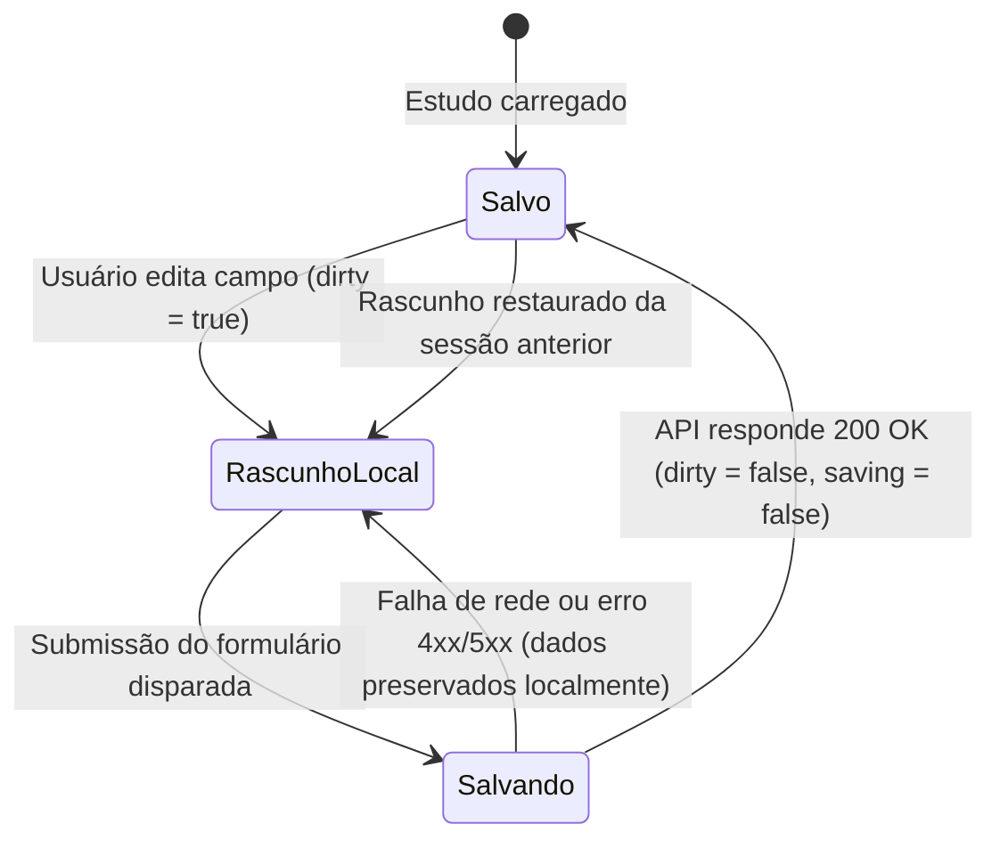

# Data Model & State Transitions: F0.9.03 — Segurança Operacional e Refinamento do Leitor de Estudos

**Feature**: `specs/084-seguranca-leitor-refinamento-estudos`  
**Parent Roadmap**: `docs/contexto/ROADMAP-0.9.md` (Feature F03)  
**Zero Emojis Policy**: Rigorosamente respeitada.

---

## 1. Entidades e Propriedades Reativas Envolvidas

### 1.1 Estado do Cabeçalho de Leitura (`StudyView.vue`)

| Propriedade / Referência | Tipo | Descrição |
| :--- | :--- | :--- |
| `canEdit` | `ComputedRef<boolean>` | Determina se o usuário logado tem permissão para editar, compartilhar e mover o estudo para a lixeira. |
| `shareModalOpen` | `Ref<boolean>` | Controla a visibilidade do modal de compartilhamento (`StudyShareModal.vue`). |
| `exportModalOpen` | `Ref<boolean>` | Controla a visibilidade do modal de exportação (`ExportModal.vue`). |
| `historyModalOpen` | `Ref<boolean>` | Controla a visibilidade do histórico de versões (`StudyHistoryModal.vue`). |
| `confirmTrashOpen` | `Ref<boolean>` | Controla a visibilidade do modal de confirmação de exclusão (`TrashConfirmModal.vue`). |

### 1.2 Máquina de Estados da Pílula de Persistência (`StudyEditView.vue`)

A pílula de persistência (`.draft-status-pill`) calcula de forma reativa o seu rótulo e seu estilo a partir de três sinais principais: `state.saving` (boolean), `dirty.value` (boolean) e `isDraftRestored.value` (boolean).

#### Tabela de Decisão de Estados da Pílula

| `state.saving` | `dirty.value` | `isDraftRestored.value` | Rótulo Exibido | Classe CSS | Semântica ARIA |
| :--- | :--- | :--- | :--- | :--- | :--- |
| `true` | Qualquer | Qualquer | "Salvando…" | `.saving` | `role="status"`, `aria-live="polite"` |
| `false` | `true` | Qualquer | "Rascunho salvo neste navegador" | `.draft-local` | `role="status"`, `aria-live="polite"` |
| `false` | `false` | `true` | "Rascunho salvo neste navegador" | `.draft-local` | `role="status"`, `aria-live="polite"` |
| `false` | `false` | `false` | "Alterações salvas" | `.saved` | `role="status"`, `aria-live="polite"` |

---

## 2. Estrutura de Menus e Ações Contextuais

### 2.1 Matriz de Permissões das Ações no Menu de `StudyView.vue`

| Ação | Identificador | Condição de Renderização | Tipo de Disparo | Nível de Risco |
| :--- | :--- | :--- | :--- | :--- |
| Compartilhar | `.share-item` | `canEdit === true` | `shareModalOpen = true; close()` | Neutro |
| Exportar | `.export-item` | Sempre | `exportModalOpen = true; close()` | Neutro |
| Histórico | `.history-item` | Sempre | `historyModalOpen = true; close()` | Neutro |
| Mover para a Lixeira | `.danger-item` | `canEdit === true` | `confirmTrashOpen = true; close()` | Alto (Destrutivo) com modal de confirmação |
